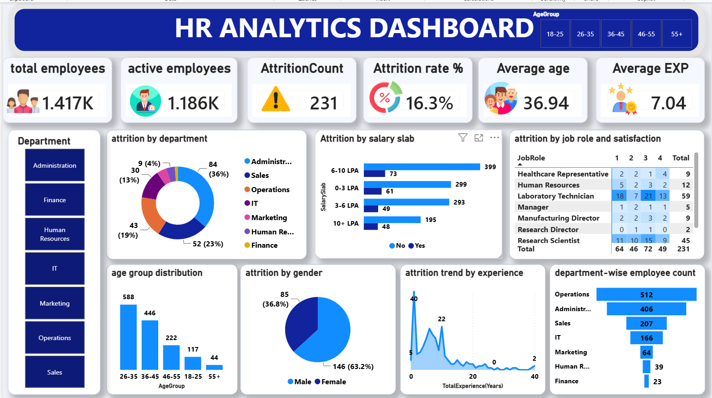

# HR Analytics Dashboard (Power BI)

Interactive Power BI dashboard that analyzes employee attrition across departments, job roles, salary slabs, age groups, gender and years of experience.

**Tools:** Power BI and DAX (measures for total employees, active employees, attrition count, attrition rate, average age and average experience), plus slicers and KPI cards.

**Key findings:** 231 of 1,417 employees left (16.3% attrition). Attrition is highest among employees with the fewest years of experience, so early-career retention is the main risk. About 63% of leavers were male.

